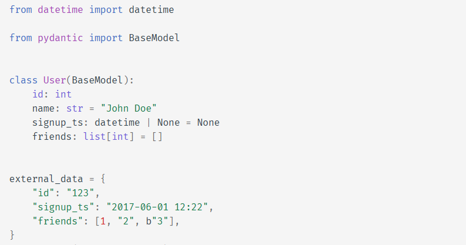
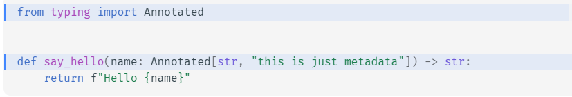
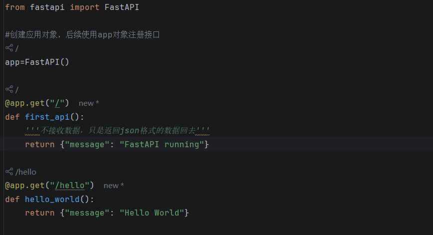
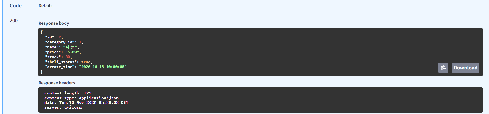
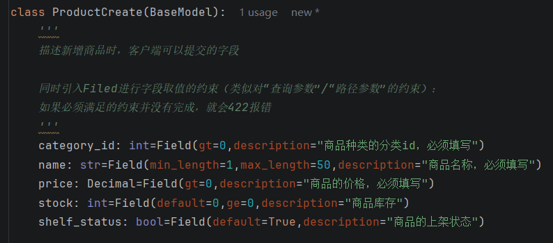

## Pydantic

Pydantic是借助“类”的形式，将一个“结构化”的数据示例，实现成一个带有“属性的类”，从而可以通过实例化对象去初始化



## Annotated

Annotated是对一个函数内参数取值的**注入**  
可以理解为：当函数执行时，这个参数的取值，就是从Annotated注入中**可选取的列表**中选取出并且给参数赋值



这里面name就是参数，后面“”中的就是**注入的元数据**

# 正式学习FastAPI

## 第一个接口的书写

### get接口的书写



### FastAPI服务的启动

terminal中启动指令：
  - app.main:这个接口方法在app文件夹的main文件中
  - :app ：这个接口依赖的注册对象是app
```
uvicorn app.main:app --reload
```

### 关于在线测试你的接口

```
http://127.0.0.1:8000/docs
```

## 路径参数，查询参数与类型校验

### 路径参数

路径参数就是：“通过url传输接口方法所需的**参数**”

实现：“/”后使用“{}”传入与参数同名的数据
```
categories = [
    {"id": 1, "name": "饮料", "create_time": "2026-10-13 08:00:00"},
    {"id": 2, "name": "数码配件", "create_time": "2026-10-13 08:00:00"},
    {"id": 3, "name": "零食", "create_time": "2026-10-13 08:00:00"},
]

products = [
    {
        "id": 1,
        "category_id": 1,
        "name": "矿泉水",
        "price": "3.50",
        "stock": 100,
        "shelf_status": True,
        "create_time": "2026-10-13 09:00:00",
    },
    {
        "id": 2,
        "category_id": 1,
        "name": "可乐",
        "price": "5.00",
        "stock": 80,
        "shelf_status": True,
        "create_time": "2026-10-13 10:00:00",
    },
    {
        "id": 3,
        "category_id": 2,
        "name": "USB 数据线",
        "price": "19.90",
        "stock": 0,
        "shelf_status": False,
        "create_time": "2026-10-13 11:00:00",
    },
]

@app.get("/products/{product_id}")
def get_product(product_id: int):
    '''通过url中的路径参数，给接口参数传值'''
    for product in products:
        if product["id"] == product_id:
            return product
    return None
```


### 固定路径与动态路径的补充


其中count接口（固定路径）必须写在路径参数接口（动态路径：url不是固定的，因为传入了参数）前。  
否则，会造成count被解析成product_id的值，造成接口调用失败

### 查询参数

即借助url的Query String来传递参数

实现：直接在接口后加上"?page=1&page_size=2"
```
@app.get("/products")
def get_page_products(
        keyword: str | None = Query(max_length=100,description="按照关键词去模糊匹配查询"),
        page: int=Query(gt=0,default=1,description="查询商品的第几页"),
        page_size: int=Query(gt=0,default=5,description="当前页面最多展示多少")):
    '''通过url中的query string（查询参数），动态给接口参数传值
    适用于：本方法（页面显示信息，动态改变的）
    '''
    filter_products=products
    #如果存在关键词查询
    if keyword and keyword.strip():
        '''这里就要根据关键词，去模糊查询，更新products数组'''
        filter_products=[]
        for product in products:
            if keyword.strip().lower() in product.get("name").lower():
                filter_products.append(product)
    start=(page-1)*page_size
    end=start+page_size
    return {
        "items": filter_products[start:end],
        "page": page,
        "page_size": page_size,
        "total_count": len(filter_products),
    }

```

### 类型校验

可以限制“路径参数”和“查询参数”的取值范围等等，违反直接422报错

这里只用知道这些，其他可以查询官方文档：

1. Query针对查询参数，Path针对路径参数

2. gt是>，ge是>=，le是<=，lt是>

## 请求体作为参数（对象）



```
@app.post("/products")
def read_product(payload: ProductCreate):
    """
    接收商品新增的数据，暂时先返回校验后数据

    在正式新增前，进行参数校验；校验成功则拼接上products数组中
    """
    name = payload.name.strip()

    if not name:
        raise HTTPException(status_code=400, detail="商品名称不能为空")
    # id_exists = False
    # for category in categories:
    #     if payload.category_id == category["id"]:
    #         id_exists = True
    #         break
    # if not id_exists:
    #     raise HTTPException(status_code=400, detail="分类ID不存在")
    if not any(payload.category_id == category["id"] for category in categories):
        raise HTTPException(status_code=400, detail="分类ID不存在")

    payload.name = name
    # 新增商品  我们需要从商品列表里找到最大的ID  再 +1 变成新的商品ID
    next_id = max((product["id"] for product in products), default=0) + 1
    payload.model_dump()
    # **dict 放到了 ProductCreate(**dict) -> name="矿泉水", price=2.23
    # **{"name": "矿泉水"} -> {"name": "矿泉水"}
    product = {
        "id": next_id,
        **payload.model_dump(),
        "create_time": datetime.now(timezone(timedelta(hours=8))).strftime(
            "%Y-%m-%d %H:%M:%S"
        ),
    }  # UTC +8
    products.append(product)
    return product
```
需要注意的几个点：

1. 请求体通过**Pydantic**的方式继承BaseModel作为**类**实现

2. 可以使用**Field**对类的**属性字段**进行限制，说明

3. 使用**model_dump()方法**可以实现“请求体”转换为JSON格式


